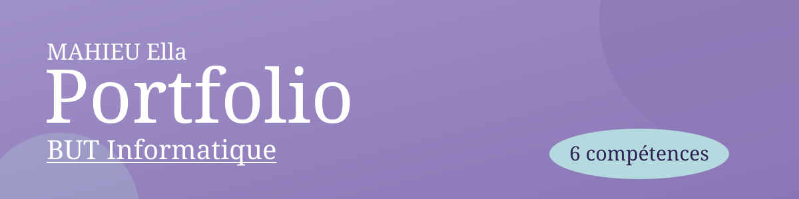

<div align="center">



### Mes traces, mes preuves et mon auto-évaluation pour les 6 compétences du BUT Informatique

[](https://pellatarte.github.io)


</div>

---

## ✨ À propos

Je suis **Ella Mahieu**, étudiante en **BUT Informatique** (deuxième année).
Ce dépôt contient mon portfolio : pour chaque compétence, je présente les travaux
qui la prouvent (TP, SAÉ, projets), une justification de mon niveau et mon auto-évaluation.

Le site est **statique** (HTML, CSS, JavaScript), sans framework, et hébergé avec **GitHub Pages**.

## 🎯 Les 6 compétences

| # | Compétence | Auto-évaluation |
| :-: | --- | :-: |
| 1 | Réaliser un développement d’application | ●●○○ Assez |
| 2 | Optimiser des applications | ●●○○ Assez |
| 3 | Administrer des systèmes informatiques communicants et complexes | ●●●○ Bien |
| 4 | Gérer des données de l’information | ●●●○ Bien + |
| 5 | Conduire un projet | ●●○○ Assez + |
| 6 | Collaborer au sein d’une équipe informatique | ●●●○ Bien + |

Échelle : ●○○○ Peu · ●●○○ Assez · ●●●○ Bien · ●●●● Très bien

## 🗂️ Structure du dépôt

```text
├── index.html     Structure de la page
├── style.css      Apparence (couleurs, polices, mise en page)
├── content.js     Contenu par défaut (compétences, traces, textes)
├── app.js         Affichage de la page + mode édition
├── content.json   (optionnel) contenu exporté, prioritaire sur content.js
└── assets/        Images du dépôt (bannière…)
```

## ✏️ Modifier le contenu

**Depuis le site (le plus simple)**
1. Ouvre la page avec `?edit` à la fin de l’adresse :
   `https://pellatarte.github.io/NOM-DU-DEPOT/?edit`
2. Clique sur n’importe quel texte pour le modifier, ajoute des traces, des captures et tes justifications.
3. Touche **Exporter content.json**, puis dépose ce fichier dans le dépôt (il remplace l’ancien).

**À la main** : modifie `content.js` (les champs sont expliqués en tête du fichier).

> Les modifications faites en mode édition restent dans le navigateur tant qu’elles ne sont pas exportées.

## 🚀 Lancer en local

Le chargement de `content.json` demande un petit serveur :

```bash
python3 -m http.server 8000
# puis ouvrir http://localhost:8000
```

## 🎨 Direction artistique

| Couleur | Code | Usage |
| --- | --- | --- |
|  Lilas | `#9A89C3` | Bandeaux, accents |
|  Violet | `#8B78B5` | Grand cercle, boutons |
|  Bleu-vert | `#B4DADF` | Bulles de niveau, légendes |
|  Encre | `#2E2352` | Texte |
|  Fond | `#F0EDF4` | Arrière-plan |

Polices : **Cormorant Garamond** (titres, soulignés) et **Poppins** (texte).

## 📬 Contact

**MAHIEU Ella** · [GitHub @pellatarte](https://github.com/pellatarte)

---

<div align="center"><sub>Fait avec soin et beaucoup de violet 💜</sub></div>
